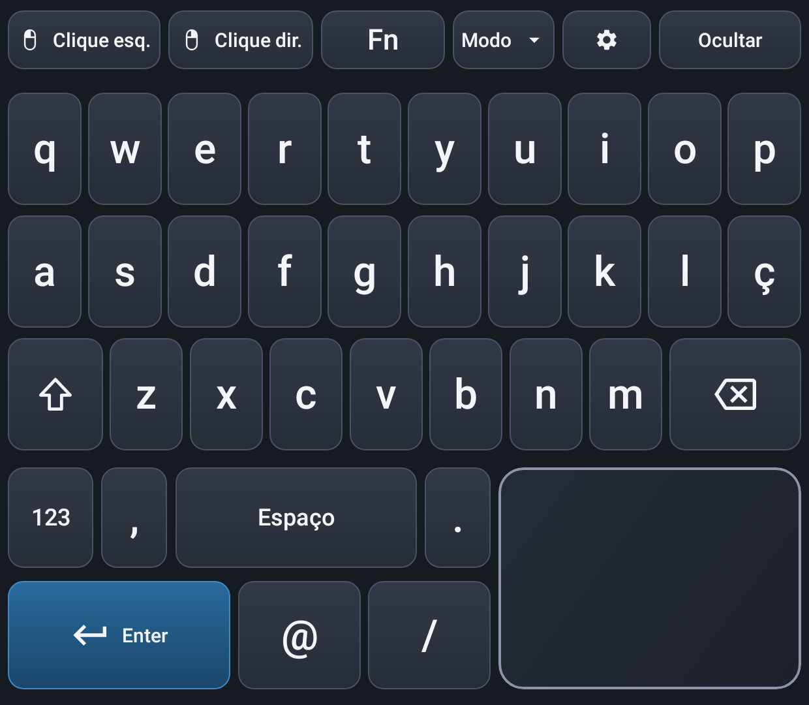

# Thor Ergo 2.0 para Android

**Teclado tátil multilingue e trackpad para o ecrã inferior do AYN Thor. Escreve
no jogo ou na aplicação do ecrã superior.**

Esta é a edição Android nativa do Thor Ergo. A versão 1.0 era uma aplicação
Linux/GTK para ArmadaOS, um fork independente do
[Armada Dual Screen Input](https://github.com/sa1utyeggs/armada-dual-screen-input).
A versão 2.0 foi reescrita em Kotlin e Jetpack Compose, com as mesmas
disposições e o mesmo comportamento.
**Design gráfico e disposição do teclado: seekingalphacrawler.**

[English](README.md) · [Arquitetura](docs/ARCHITECTURE.md) · [Créditos](CREDITS.md) · [Avisos de terceiros](THIRD_PARTY.md)

> **Estado:** compila e passa nos testes automáticos. **Ainda não foi
> experimentada num AYN Thor.** Consulta [SUPPORT.md](SUPPORT.md).

## Funcionalidades

- Teclas grandes, trackpad no canto inferior direito, botões de rato e páginas
  de números, símbolos e Fn.
- Shift e Caps Lock com legendas a acompanhar.
- Mantém uma letra premida, desliza até ao acento e levanta o dedo para o
  escrever.
- Sete disposições, com o idioma da interface independente do idioma do
  sistema.
- Pinyin offline.
- Trackpad:
  - aceleração;
  - toque para clicar;
  - clique direito com dois dedos;
  - scroll;
  - inércia.
- **Apagar o ecrã inferior.** Substitui o botão AYN da versão 1.0. Desliga só o
  painel inferior; o jogo continua. Pode ser acionado pelo menu ou por uma tecla
  física associada.

## Como funciona

O painel é uma janela sobreposta, sem foco, no ecrã inferior, por isso o jogo
mantém o foco. Há duas formas de enviar a entrada:

- **Shizuku** (recomendado): envia teclas, rato e toques reais a qualquer
  aplicação e pode desligar o painel inferior.
- **Serviço de acessibilidade**: escreve texto acentuado e chinês no campo
  ativo e trata a tecla física. Sem Shizuku, funciona em modo limitado.

## Instalação

1. Instala o APK no Thor (Android 13 ou posterior).
2. Instala e inicia o Shizuku.
3. Abre o Thor Ergo e segue a lista de verificação.
4. Toca em **Iniciar o painel do teclado**.

## Licença

MIT. O índice Pinyin deriva do xpinyin e é distribuído sob a LPPL 1.3c; consulta
[THIRD_PARTY.md](THIRD_PARTY.md).
