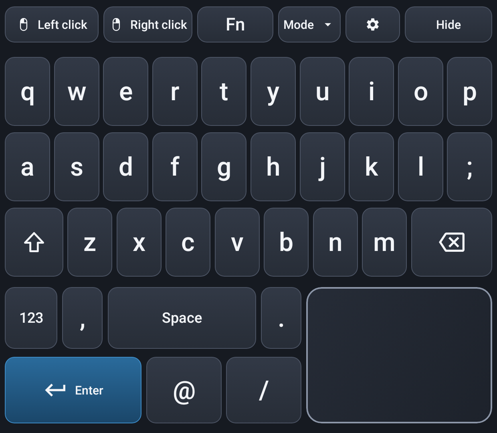

# Thor KBM

**A multilingual touchscreen keyboard and trackpad for the lower screen of the
AYN Thor, typing into the game or app on the upper screen.**

Thor KBM is a native Android fork of
[Thor Ergo](https://github.com/seekingalphacrawler/Thor-Ergo), the ArmadaOS
version. That version is a Linux/GTK fork of
[Armada Dual Screen Input](https://github.com/sa1utyeggs/armada-dual-screen-input).
It is rebuilt in Kotlin and Jetpack Compose with the same layouts and behavior.
**Graphic design and keyboard layout: seekingalphacrawler.**

[Português](README-PT.md) · [Architecture](docs/ARCHITECTURE.md) · [Credits](CREDITS.md) · [Third-party notices](THIRD_PARTY.md)



*Rendered by the app's own Compose code at the Thor's lower-screen size
(1240 × 1080). These are screenshot-test images, not device photos.*

> **Status:** builds and passes its automated tests. It has **not yet been
> tried on an AYN Thor**. See [Support](SUPPORT.md) for what that means.

## Features

- Large keys, a trackpad in the bottom-right corner, header mouse buttons, and
  number, symbol and Fn pages. The arrow keys are on the alternative pages.
- Shift and Caps Lock: tap once for the next letter, double-tap to lock. Legends
  follow the case.
- Hold a letter, slide to an accent and release to type it.
- Seven layouts with translated menus: English (US), Português, Español,
  Français, Deutsch, Italiano and 简体中文 with offline Pinyin. The interface
  language can follow the keyboard or be set separately, without changing the
  system language.
- Trackpad:
  - pointer acceleration;
  - tap to click and two-finger right-click;
  - two-finger scroll with fine scaling;
  - inertial glide;
  - drag while holding a header mouse button.
- Three views: keyboard + touchpad, keyboard only, touchpad only.
- **Lower screen off.** This replaces the ArmadaOS version's AYN-button feature. It powers off
  only the lower panel; the game keeps running. You can trigger it from the menu
  or from a hardware key you bind.

## How it works on Android

The panel is a non-focusable overlay window on the lower display, so the game
on the upper display keeps input focus. Input reaches the game in two ways:

| Backend | What it enables |
|---|---|
| **[Shizuku](https://shizuku.rikka.app/)** (recommended) | Real key events, mouse movement, clicks and scrolling for any app, including games. It can also power off the lower panel. |
| **Accessibility service** | Accented and Chinese text in the focused field, plus the hardware-key toggle. Without Shizuku, keys and taps only reach focused text fields. |

A glove pointer on the upper screen shows where the trackpad is pointing. Some
games ignore mouse input. For those, turn on **Settings → Mouse → Clicks as
screen touches**.

## Install

1. Build or download the APK and install it on the Thor (Android 13 or later):
   `./gradlew :app:assembleDebug`, then
   `adb install app/build/outputs/apk/debug/app-debug.apk`.
2. Install and start **Shizuku**.
3. Open **Thor KBM** and work through the checklist:
   1. Display over other apps.
   2. Shizuku: allow.
   3. Accessibility service.
   4. Notifications.
4. Tap **Start keyboard panel**.

The notification's **Stop** action ends the panel. Stopping always turns the
lower screen back on and releases any held key or button.

## Build and test

You need JDK 17 or later and the Android SDK (API 36).

```sh
./gradlew test                    # every unit and Robolectric test
./gradlew recordRoborazziDebug    # refresh feature/panel/src/test/screenshots
./gradlew lintDebug
./gradlew :app:assembleDebug
```

### Debug and release

| | Debug | Release |
|---|---|---|
| App id | `jr.brian.thorkbm.debug` | `jr.brian.thorkbm` |
| Name | Thor KBM Debug | Thor KBM |
| Signed with | the Android debug key | your release key |
| Build | `./gradlew :app:assembleDebug` | `./gradlew :app:assembleRelease` |

The two are separate apps, so both can be installed together. Each needs its
own permissions, Shizuku grant and accessibility service.

To sign release builds, copy `keystore.properties.example` to
`keystore.properties` and fill in your key. That file is git-ignored. On CI the key comes from the repository
secrets `KEYSTORE_B64` (`base64 -i thor-ergo-release.jks`), `KEYSTORE_PASSWORD`
and `KEY_ALIAS`; see `.github/workflows/`. Without a key, release builds are left unsigned.

The keyboard, trackpad, Pinyin and dead-key logic are pure Kotlin modules. Their
tests are ported from the ArmadaOS version's test suite.

## License

MIT: see [LICENSE](LICENSE). The Pinyin index is derived from xpinyin and is
distributed under the LPPL 1.3c. Its sources and the builder are in
`licenses/xpinyin/` and `tools/pinyin/`; see [THIRD_PARTY.md](THIRD_PARTY.md).
