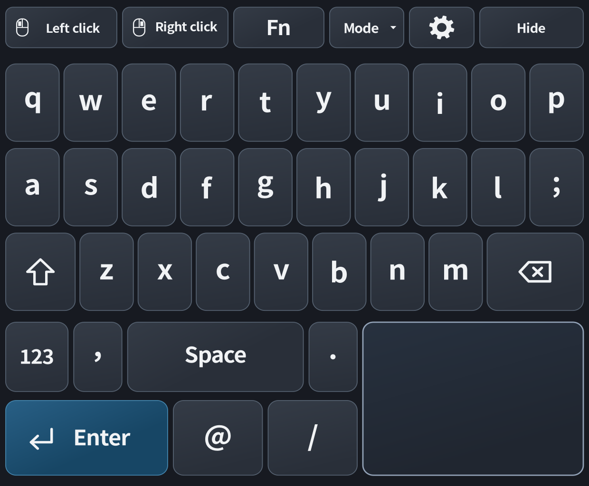
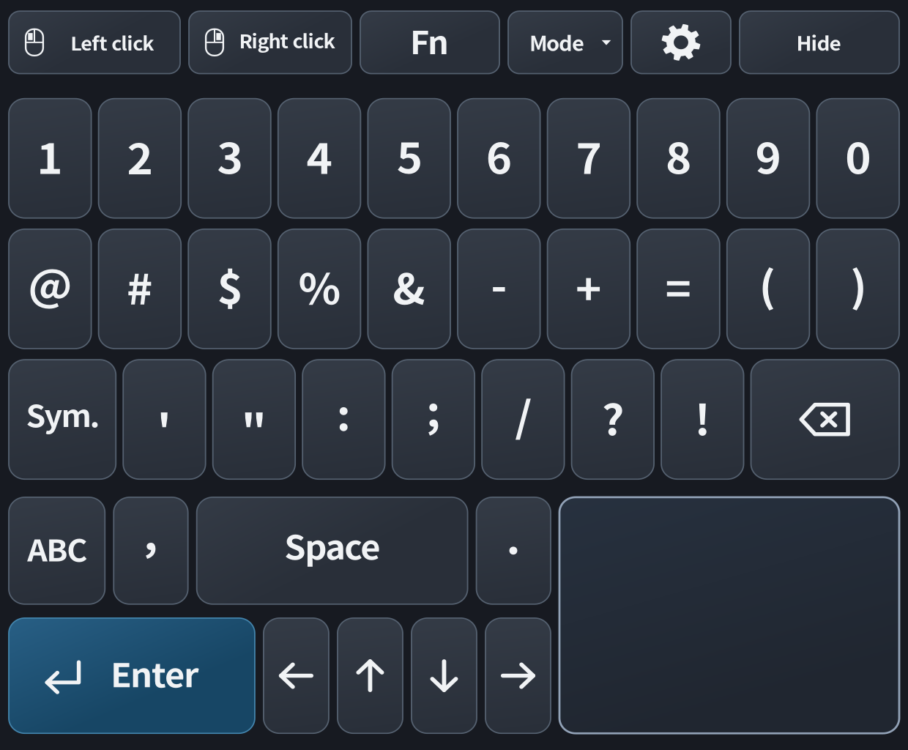
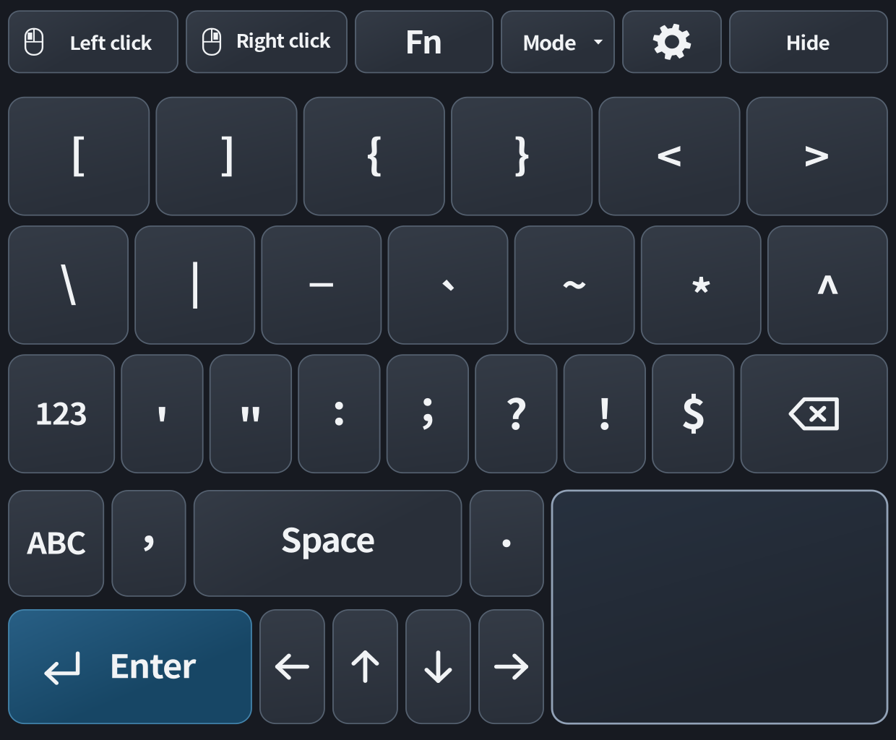
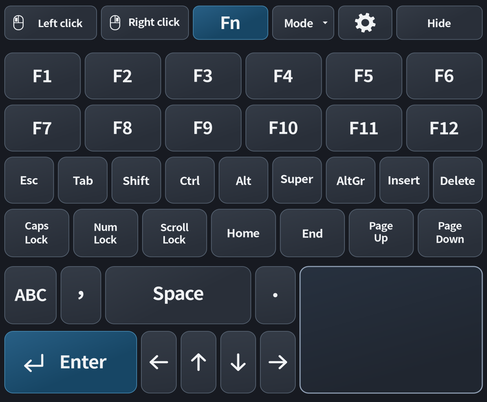
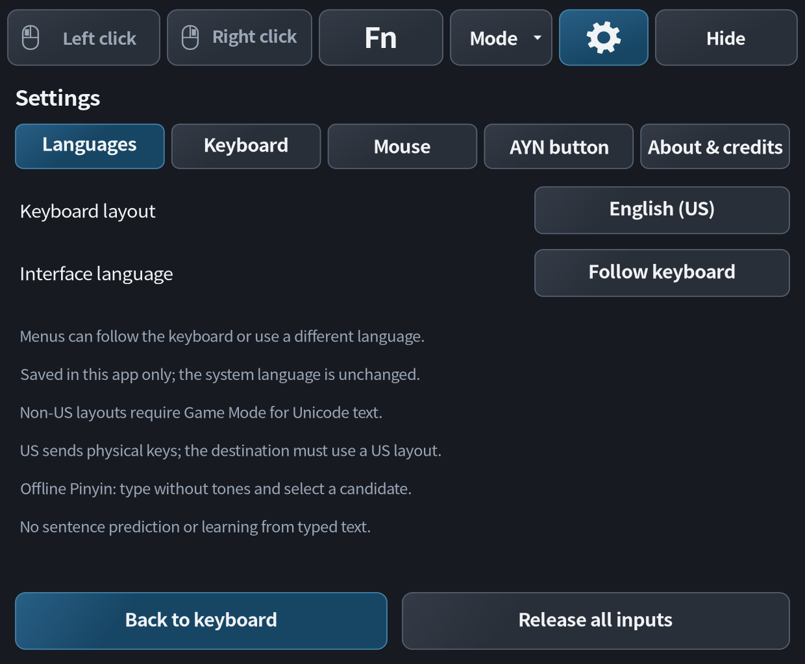
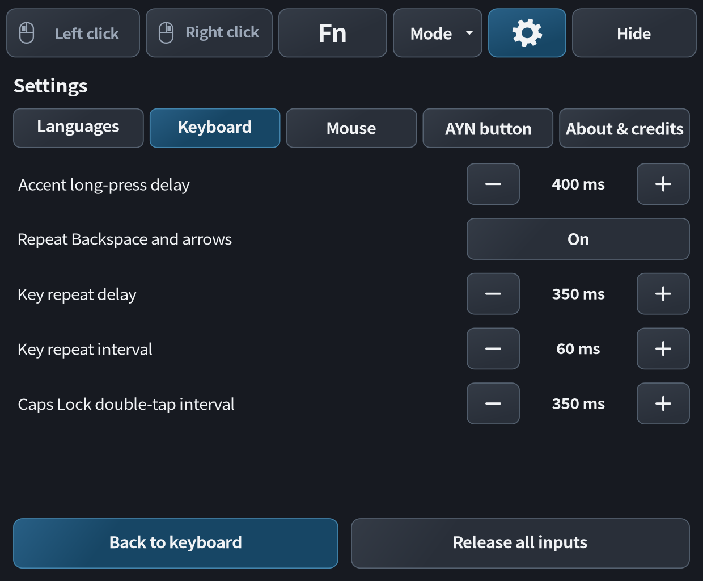
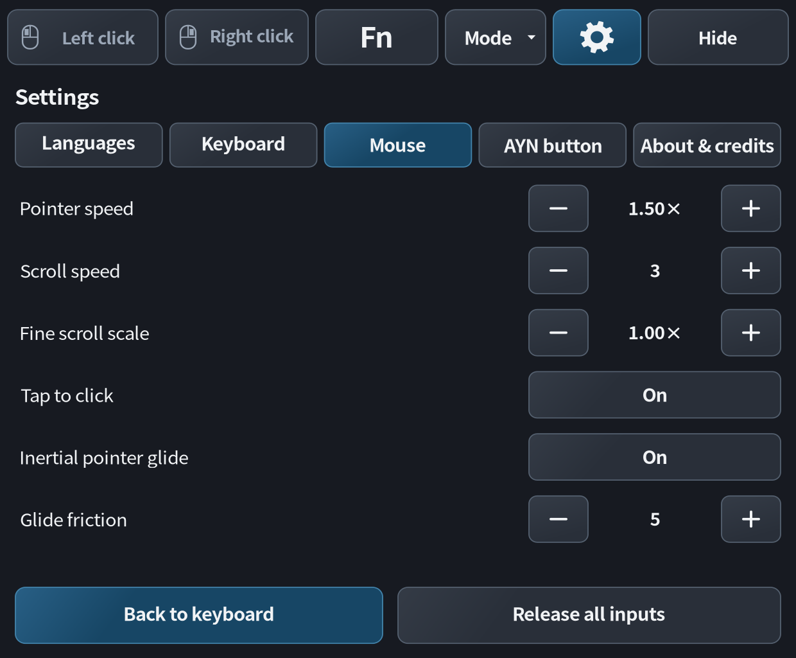
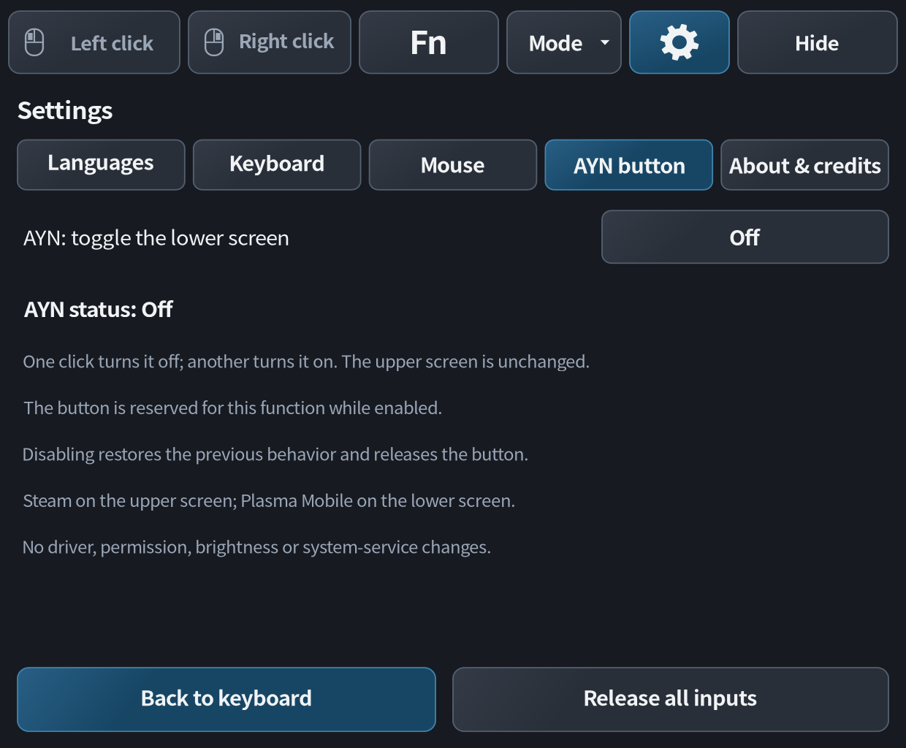
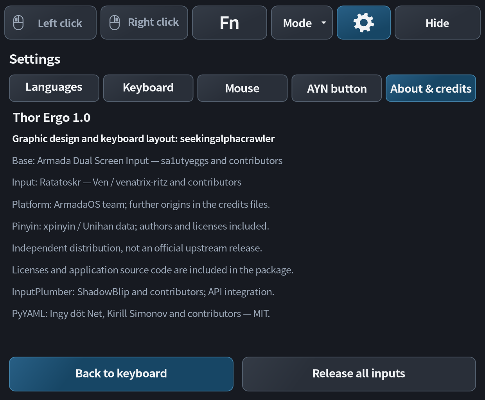

# Thor Ergo 1.0

**A multilingual touchscreen keyboard and trackpad for the lower screen of the
AYN Thor running ArmadaOS.**

An independent fork of [Armada Dual Screen Input](https://github.com/sa1utyeggs/armada-dual-screen-input),
with an ergonomic interface, large touch targets and seven keyboard layouts.
**Graphic design and keyboard layout: seekingalphacrawler.**

[Português](README-PT.md) · [Download version 1.0](https://github.com/seekingalphacrawler/Thor-Ergo/releases/tag/v1.0) · [Interface guide](docs/INTERFACE.md) · [Credits](CREDITS.md)

*Interface previews are rendered from the application's own drawing code. They
show the app area, not a photograph of a Thor or a simulated Plasma status bar.
Actual font rendering and available height depend on the device session.*

## Tested environment

| Component | Tested setup |
|---|---|
| Installation computer | **Windows 11** |
| Handheld | **AYN Thor Pro — 12 GB RAM** |
| Operating system | **ArmadaOS 20261109.dfed5d6** (20261109 release) |
| Upper screen | Steam Game Mode, started and unlocked |
| Lower screen | **Plasma Mobile enabled** in Armada Control |

**macOS and Linux installers are included, but have not been tested by the
maintainer on those operating systems.** Other hardware/OS versions and every
language/game combination are not covered by this test report.

This is a completed personal project, shared as-is, with no active maintenance
or support commitment. Community forks are welcome. [Support and limitations](SUPPORT.md).

## Features

- Large letter keys, a fixed lower-right touchpad, dedicated mouse buttons,
  separate numbers/symbols/Fn pages, and arrows on the alternate pages.
- Lowercase/uppercase labels follow Shift and Caps Lock. Hold an eligible letter,
  slide to an accented variant, and release to type it.
- Seven keyboard layouts and translated menus, with independent keyboard and
  interface-language choices or automatic matching.
- Optional **AYN button** control: one press turns the lower panel off and the
  next turns it on, without closing Plasma Mobile or suspending the Thor.
- Complete user-level installation, SSH deployment, diagnostics and Undo.

## Download and install

Download **`Thor-Ergo-1.0.zip`** from [Releases](https://github.com/seekingalphacrawler/Thor-Ergo/releases/tag/v1.0).
Choose that named asset, not GitHub's automatically generated **Source code** archives.
Extract the entire folder before running an installer.

### Prepare the Thor

Enable SSH, connect the computer and Thor to the same local network, save your
work and close games. Keep the Thor awake with all buttons released.

**Upper screen: Steam Game Mode started and unlocked. Lower screen: Plasma
Mobile enabled through Armada Control on the upper screen. Do not switch the
whole Thor to Desktop Mode.** The installer checks the lower session but does
not enable it automatically.

### Choose the installer

| Computer / execution location | File or command |
|---|---|
| **Windows 11 — tested** | Double-click `Install-Windows.cmd`; do not run as administrator |
| macOS — not tested by the maintainer | In Terminal, inside the extracted folder: `sh Install-macOS.command` |
| Linux — not tested by the maintainer | In a terminal, inside the extracted folder: `sh Install-Linux.sh` |
| Directly on the Thor, including an SSH shell | Inside the extracted folder: `sh Install-on-Thor.sh` |

The Windows/macOS/Linux scripts install **onto the Thor over SSH**. They do not
run the keyboard on the computer. Windows needs PowerShell 5.1+ and OpenSSH Client;
macOS/Linux need OpenSSH and standard POSIX command-line tools. No host Python
installation is required.

Choose **1 — Install / update** and enter the local IP, SSH user (default
`armada`) and port (default `22`). The installer shows **SSH password (default:
"armada")**; enter the current password in OpenSSH's prompt. Passwords are not
stored by the installer. Existing SSH-key authentication is supported. Verify
new SSH fingerprints; changed host keys are not silently accepted or removed.

The archive contains the full app, source, private GtkLayerShell runtime, offline
Pinyin data and licenses. **No prior application or patch is required.** The
installer does not download packages, use sudo, unlock the OS or change input
permissions. It tests a separate complete copy, then requires a live first frame;
activation failure requests automatic rollback. Existing compatible preferences
and the prior installation can be retained for Undo.

## Keyboard languages

| Keyboard | Layout and characters |
|---|---|
| English (US) | US QWERTY and punctuation |
| Português (Portugal) | QWERTY, ç and Portuguese accents |
| Español (España) | QWERTY, ñ, ¿, ¡ and accented vowels |
| Français (France) | AZERTY and French accents |
| Deutsch (Deutschland) | QWERTZ, ä, ö, ü and ß |
| Italiano (Italia) | QWERTY and accented vowels |
| 简体中文 | Offline Pinyin composition with selectable, paginated candidates |

Open the gear button → **Languages**. Menu language may follow the keyboard or
be selected separately. The Chinese composer is a basic offline implementation,
not a contextual predictive keyboard; it does not learn or store typing history.
Non-US text uses a private Gamescope text-input interface: support depends on
the destination application/game. US physical keys assume a US destination layout.
System-wide keyboard settings are not changed.

## Menus and controls

| Numbers and punctuation | Symbols and accents |
|---|---|
|  |  |

| Function keys | Languages |
|---|---|
|  |  |

| Keyboard settings | Mouse settings |
|---|---|
|  |  |

| AYN button | About and credits |
|---|---|
|  |  |

See the [interface guide](docs/INTERFACE.md) for full-size images,
Portuguese typing, accent selection and Pinyin examples.

## AYN button: lower-screen toggle

With games closed and all buttons released, open **Settings → AYN button** and
enable the option. It defaults to **Off** after installation. Wait for **Ready**
and the InputPlumber routing indication. Press AYN once to turn the lower panel
off and again to turn it on. The helper runs independently of the keyboard window.

Only the AYN mapping is temporarily routed through InputPlumber. Disabling the
option attempts to restore the earlier mapping. Disable it before changing
controller profiles or assigning AYN to another application. A private recovery
snapshot remains on the Thor; do not publish it. No raw-device access, global
keyboard capture, permission changes or Plasma shortcuts are required.

## Undo, diagnostics and recovery

Run the installer again and choose **2 — Undo**, **3 — Diagnostics**, or
**4 — Wake lower screen**. Dedicated `Diagnose-AYN-*` launchers are also included.
Undo restores the immediately preceding installation/preferences; on a fresh
installation it removes the created services and launchers. Review diagnostics
before sharing them, because live output can contain local names and paths.

The application is installed under the user's `~/.local/share/thor-ergo/`,
`~/.config/thor-ergo/` and user-level systemd directories, not the immutable OS
image. Normal ArmadaOS updates should preserve those files, but **continued
compatibility is not guaranteed**. An actual OTA upgrade has not been validated.
A reflash/reset that erases user data is different.

## Source and credits

Application source: `distribution/Thor/app/src/`; retained input components: `distribution/Thor/app/vendor/`;
installers and tests are included. Run isolated checks with
`python3 -B distribution/Thor/selftest.py` where the test dependencies are available.

See [CREDITS.md](CREDITS.md), [LICENSE](LICENSE), and
[third-party notices](distribution/Thor/app/THIRD_PARTY.md). Original authors and licenses are
preserved. This fork is not endorsed by AYN, ArmadaOS, Valve or the upstream
projects. **Graphic design and keyboard layout: seekingalphacrawler.**
